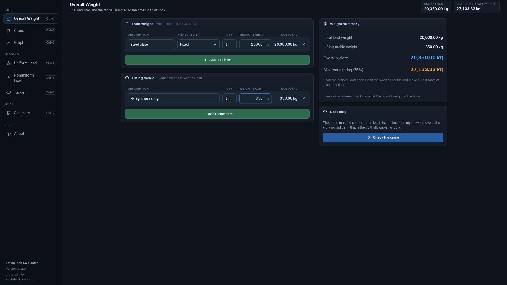
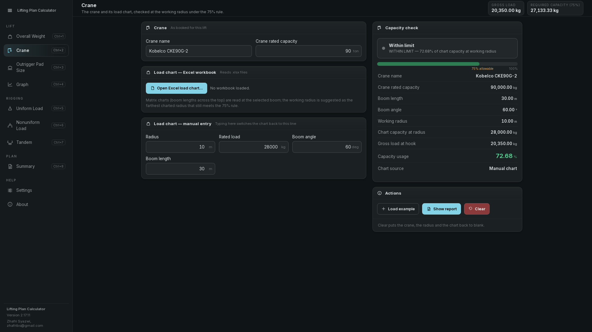
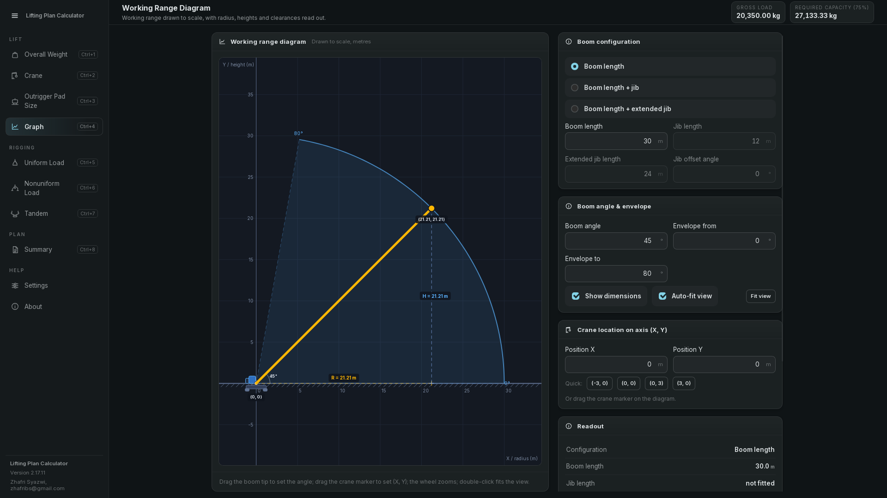
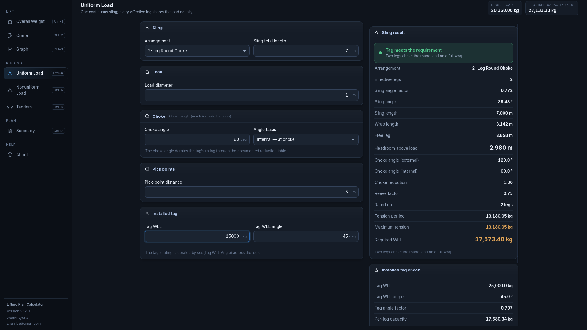
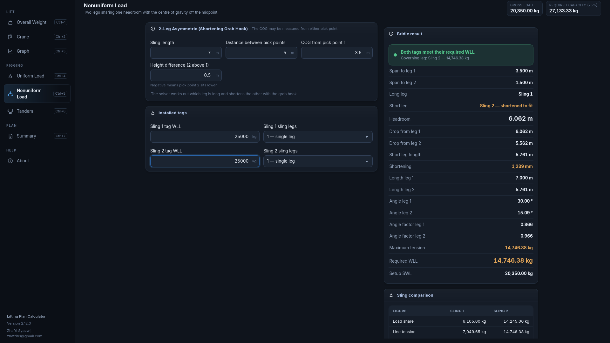
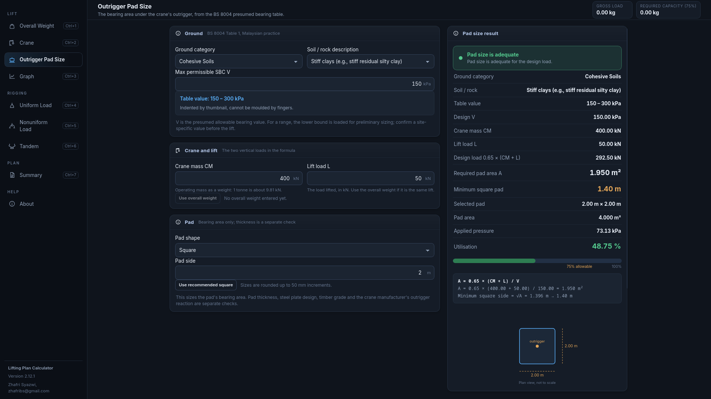
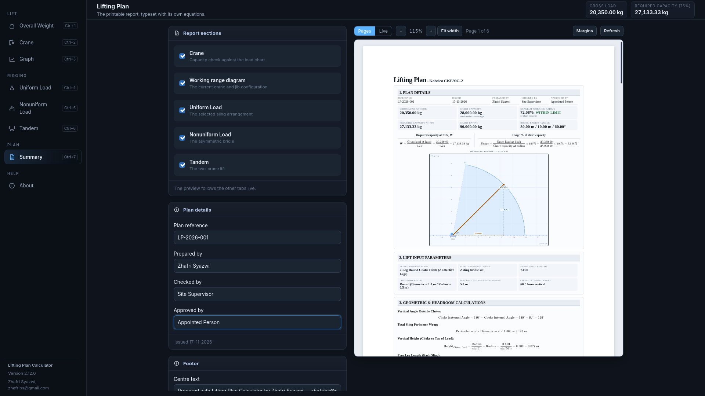
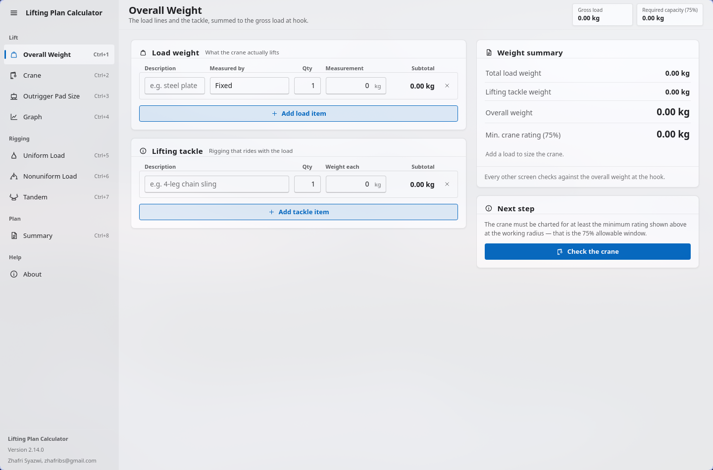
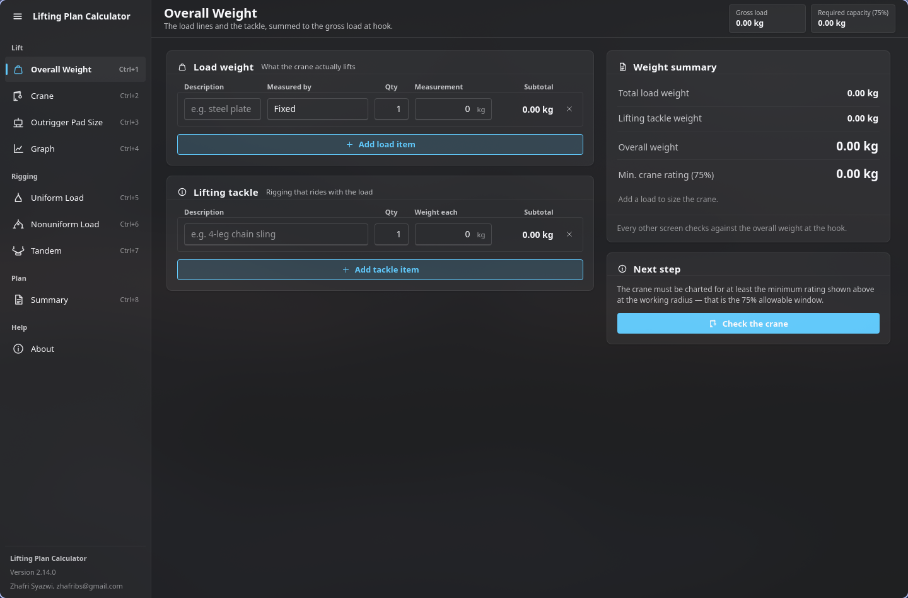
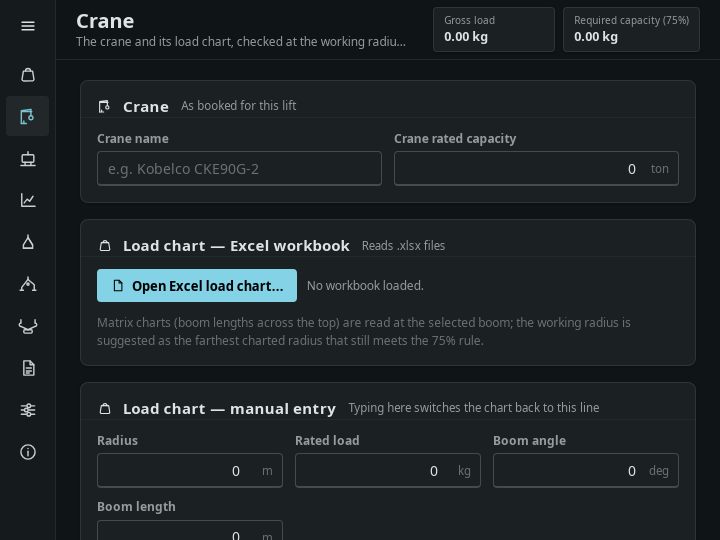

<p align="center">
  
</p>

<h1 align="center">Lifting Plan Calculator</h1>

<p align="center">
  Plan a crane lift, check it against the crane's own load chart, and print the
  working — every figure comes with the formula that produced it.
</p>

<p align="center">
  <a href="https://github.com/zhafribs/lifting-plan-calculator/actions/workflows/ci.yml"></a>
  <a href="https://github.com/zhafribs/lifting-plan-calculator/releases/latest"></a>
  <a href="https://github.com/zhafribs/lifting-plan-calculator/releases"></a>
  <a href="LICENSE"></a>
  <br>
  
  
  
</p>



## What it is

- A desktop app for **Linux and Windows**. No sign-in, no account, no data
  leaves your machine.
- It adds the load and the rigging, checks the crane against its own load
  chart, sizes the slings, and builds a printable plan.
- Every figure in the printed plan shows its formula and the numbers behind it,
  so a reviewer can check the arithmetic instead of taking it on trust.
- Plans are not saved between launches. **Save plan** on the Summary keeps one;
  **Save as PDF** or **Save as HTML** keeps a copy to print or share.

New here? Read the [step-by-step tutorial](docs/tutorial.md) or watch the
[52-second walkthrough](docs/video/tutorial.mp4).

## Download

| Platform | File | Notes |
| --- | --- | --- |
| **Linux** (recommended) | `Lifting-Plan-Calculator-<version>-linux-x86_64.AppImage` | One file, nothing to install. Ubuntu 22.04+, Fedora 36+, Arch. |
| **Debian / Ubuntu** | `Lifting-Plan-Calculator-<version>-linux-amd64.deb` | `sudo apt install ./<file>.deb` |
| **Fedora / RHEL** | `Lifting-Plan-Calculator-<version>-linux-x86_64.rpm` | `sudo dnf install ./<file>.rpm` |
| **Arch Linux** | `Lifting-Plan-Calculator-<version>-linux-x86_64.pkg.tar.zst` | `sudo pacman -U ./<file>` |
| **Any Linux (Flatpak)** | `Lifting-Plan-Calculator-<version>-linux-x86_64.flatpak` | `flatpak install ./<file>.flatpak` |
| **Windows** 10/11 x64 | `Lifting-Plan-Calculator-<version>-windows-x86_64.msi` | Installs for all users; administrator prompt. |
| **Windows** 10/11 x64 | `Lifting-Plan-Calculator-<version>-windows-x86_64-setup.exe` | Same install, as a single setup file. |

All files, checksums and notes are on the
[**Releases page**](https://github.com/zhafribs/lifting-plan-calculator/releases/latest).

### Linux in one command

```bash
chmod +x Lifting-Plan-Calculator-<version>-linux-x86_64.AppImage
./Lifting-Plan-Calculator-<version>-linux-x86_64.AppImage
```

The AppImage carries the GTK and WebKit libraries it needs, so the target
machine does not need anything installed for it.

### Windows

The installer puts the app in `C:\Program Files\Lifting Plan Calculator`: the
executable, the uninstaller, the licence and the third-party notices. The
interface, the maths rendering and the PDF viewer are inside the executable, so
there is no runtime folder to lose. The only shared piece is Microsoft's
WebView2, which Windows 10 and 11 already have with Edge; the installer carries
a bootstrapper for a machine that does not.

Windows SmartScreen will say **Unknown publisher**. The installers are not
signed with a commercial certificate. Updates are still checked with the
project's own signature before they run (below).

### Check a download

Download `SHA256SUMS.txt` beside the file, then check just that file:

```bash
sha256sum -c --ignore-missing SHA256SUMS.txt
```

`SHA256SUMS.txt.sig` is an Ed25519 signature over the checksum file. The public
key is [`src-tauri/update-public-key.txt`](src-tauri/update-public-key.txt). The
app checks both before it trusts an update. A manual download can be checked
with the same key.

### Update

- **Windows:** the update reminder can download and start the new installer,
  then closes so the installer can replace the running files.
- **Linux:** the update button downloads the new AppImage, checks it, replaces
  the running file and restarts. The old file is removed after the new one
  starts.
- `SHA256SUMS.txt.sig` is checked first, then the download's digest. An update
  that fails either check is not run.
- The release also ships a `.zsync` file, so `appimageupdatetool` can download
  only the parts that changed.

## What it checks

| Tab | What it does |
| --- | --- |
| **Overall Weight** | Load lines and lifting tackle. Lines with the same lift add up; the heaviest lift sizes the plan. |
| **Crane** | The capacity check against an Excel load chart, or one point typed by hand. |
| **Outrigger Pad Size** | The minimum pad under one outrigger, from the BS 8004 ground table. |
| **Uniform Load** | 1-leg, 2-leg, nested and bridle sling arrangements. |
| **Nonuniform Load** | A 2-leg bridle with a shortening grab hook. |
| **Tandem** | Two cranes sharing one load, with the declared tilt. |
| **Summary** | The printable plan, with formulas, ready to save or print. |
| **Graph** | A working-range diagram drawn to scale. |

### The 75% rule

The required chart capacity is the load at the hook divided by 0.75. At or below
75% of the charted capacity the plan reads **WITHIN LIMIT**, between 75% and
100% **CAUTION**, and over 100% **WARNING**.

The chart is the only rating checked. The crane's rated capacity is printed for
the record, not used as a second test. A working radius outside the chart's
range is refused, with the range named, rather than using the nearest value.

## Screenshots

These use a 20,000 kg load and 350 kg of tackle, so the hook load is 20,350 kg
and the required chart capacity is 27,133.33 kg. The manual check uses a
28,000 kg chart point at 10 m, which shows the green **WITHIN LIMIT** band at
72.68%.

| Overall Weight | Crane capacity check |
| --- | --- |
|  |  |
| **Working range diagram** | **Uniform Load** |
|  |  |
| **Nonuniform Load** | **Tandem** |
|  |  |

**Outrigger Pad Size** — a 400 kN crane mass, a 50 kN lift and stiff clay at
150 kPa. That gives a 1.950 m² pad area and a 1.40 m square pad:



**Summary report** — the printable plan, with the working shown as formulas:



## Privacy

- No sign-in. No plan is stored between launches unless you save one.
- The app asks GitHub once at launch whether a newer release exists, and again
  only if you press the check button in About. Nothing else is sent.
- Files are written only when you save a plan or a report, when you change the
  appearance (the scheme and palette are kept in `appearance.json`), when you
  download an installer, or when the app writes its small startup log at
  `~/.cache/lifting-plan-calculator/ui.log`.

## Scope of use

This is a calculation aid for a competent person planning a lift. It does not
certify a lift, a crane, an operator or a plan, and it does not replace the
manufacturer's load chart, the crane's rated capacity, the site's lift plan
procedure, or a rigger's and appointed person's judgement.

Every figure is only as good as the inputs and the chart it was read from.
Check both against the source before the lift. A printed plan remains the
responsibility of the person who approves it.

## Windows 11

The Windows build uses the Windows 11 look:

- a native title bar over **Mica**, with the Fluent navigation rail beside it;
- the rail folds to a 56 px icon strip with the hamburger in its header;
- system light/dark and the Windows accent colour are followed live;
- Windows 10 keeps the same layout on solid surfaces, because Mica is not
  available there;
- the calculations, the report and the PDF are the same on every platform.

| Light | Dark |
| --- | --- |
|  |  |

At the minimum window size the labels fold away and the icons keep their
tooltips and shortcuts:



These three are layout previews captured on Linux with
`cargo run -- --platform-preview=windows`. The Windows build adds Mica behind
the native title bar.

## Build from source

```bash
git clone https://github.com/zhafribs/lifting-plan-calculator.git
cd lifting-plan-calculator/src-tauri
cargo run            # opens the app
```

The interface lives in `ui/` and is built into the executable. There is no Node
step and no npm dependency. The calculation engine is a Rust port of the
original Android app, and it carries the Kotlin tests' own expected figures; a
drift in the arithmetic fails the build.

To build an AppImage on this machine:

```bash
./build-appimage.sh
```

Output goes to `dist/`. Documentation for the code is in
[`AGENTS.md`](AGENTS.md) and the decisions in [`docs/adr/`](docs/adr/).

## Help

- [Tutorial](docs/tutorial.md) — every tab, in order, with screenshots.
- [Walkthrough video](docs/video/tutorial.mp4) — 52 seconds, from load to PDF.
- [Releases](https://github.com/zhafribs/lifting-plan-calculator/releases) —
  downloads and per-release notes.
- [Report a bug](https://github.com/zhafribs/lifting-plan-calculator/issues/new/choose).
- [Security policy](https://github.com/zhafribs/lifting-plan-calculator/security/policy).

## License

GNU General Public License, version 3 or later. See [LICENSE](LICENSE).
