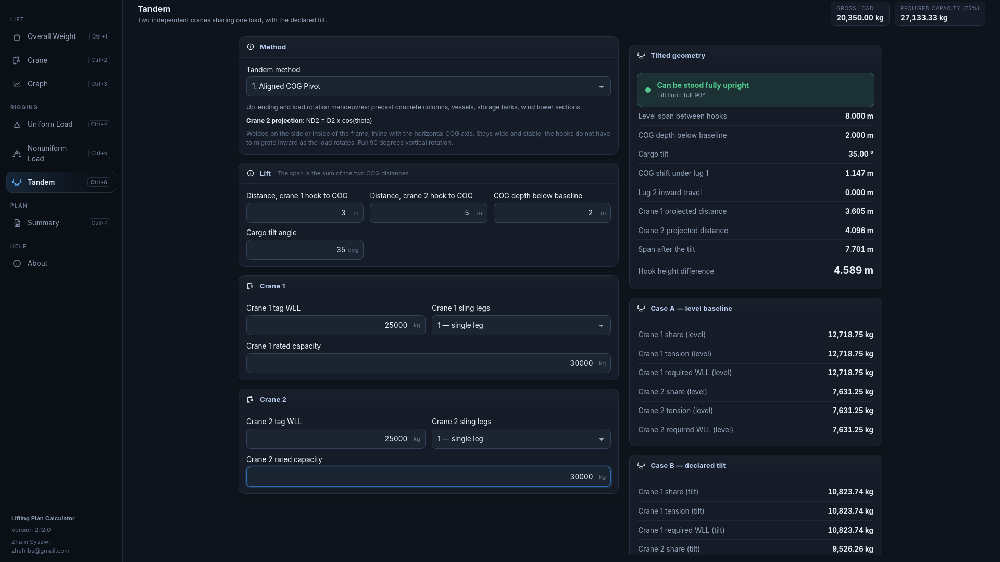

<p align="center">
  
</p>

<h1 align="center">Lifting Plan Calculator</h1>

<p align="center">
  A desktop lift plan that shows its arithmetic — every figure in the printable
  report is written as the formula that produced it.
</p>

<p align="center">
  <a href="https://github.com/zhafribs/lifting-plan-calculator/actions/workflows/ci.yml"></a>
  <a href="https://github.com/zhafribs/lifting-plan-calculator/releases/latest"></a>
  <a href="https://github.com/zhafribs/lifting-plan-calculator/releases"></a>
  <a href="LICENSE"></a>
  <br>
  
  
  
</p>


Lifting Plan Calculator is a desktop app for planning a crane lift and printing
the working. It adds up the load at the hook, checks the crane against its own
load chart, sizes the slings, and builds a report that shows every formula and
the values behind it.

It runs on Linux and Windows, needs no sign-in, and keeps no plan between
launches. The calculation engine is a Rust port of the original Android app,
with the Kotlin tests' own expected figures. A drift in the arithmetic fails the
build.

New to the app? Start with the [tutorial](docs/tutorial.md) or watch the
[52-second walkthrough](docs/video/tutorial.mp4).

The app asks GitHub once at launch whether a newer release exists, and only
again if you ask from About. On Windows it can download the installer you
choose. Nothing else leaves the machine. Files are written only when you save a
report, download an installer, or write the small
`~/.cache/lifting-plan-calculator/ui.log` log used to diagnose startup problems.

## What's new in 2.13.1

Released 17 November 2026. The Outrigger Pad Size form is easier to use and
reuses the rest of the sheet.

- **Ctrl+3** opens Outrigger Pad Size. Graph, Uniform Load, Nonuniform Load,
  Tandem and Summary move to **Ctrl+4** through **Ctrl+8**.
- **Crane mass (CM)** defaults to the Crane tab's rated capacity, and
  **Lift load (L)** defaults to the Overall Weight gross load. Editing either
  field breaks the link; the two buttons reconnect it.
- The bearing-value row has more space, its field is narrower, and the `kPa`
  unit is sized with the rest of the form.

The full notes are in [`docs/releases/v2.13.1.md`](docs/releases/v2.13.1.md).

## What's new in 2.13.0

Released 17 November 2026. The new **Outrigger Pad Size** tab, and the Linux
AppImage can now update itself.

- The new tab sizes the bearing area under one outrigger from the BS 8004
  Table 1 presumed allowable bearing values, with a selectable ground row, the
  `A = 0.65 x (CM + L) / V` formula and a selected-pad check.
- The Linux update button downloads the new AppImage, verifies its signed
  checksum, replaces the running file and restarts. The old file is removed
  after the new one starts.
- The Excel workbook table opens collapsed after an import, so the boom and
  radius controls stay in view.

The full notes are in [`docs/releases/v2.13.0.md`](docs/releases/v2.13.0.md).

## What's new in 2.12.1

Released 17 November 2026. The Windows Summary page view no longer flashes a
white print window when it refreshes. The print path now uses headless Edge,
with the app's own hidden WebView2 printer as the fallback. Linux and the report
itself are unchanged.

The full notes are in [`docs/releases/v2.12.1.md`](docs/releases/v2.12.1.md).

## What's new in 2.12.0

Released 17 November 2026. The window now runs under a Content-Security-Policy,
and the crane tab's jib rules use the chart's own basis.

- Scripts load only from the app's own origin, and the report's KaTeX pass is a
  bundled file rather than an inline script.
- Going back to **Boom length** restores the main boom instead of keeping the
  jib's reach.
- A crane with no extended jib no longer offers that configuration on the Crane
  or Graph tab.
- The Graph tab's boom angle now drives the Crane tab, with or without a
  workbook.
- A jib boom angle between chart rows is checked at the lower row, never the
  higher one.

The full notes are in [`docs/releases/v2.12.0.md`](docs/releases/v2.12.0.md).

## Scope of use

This is a calculation aid for a competent person planning a lift. It does not
certify a lift, a crane, an operator or a plan, and it is not a substitute for
the manufacturer's load chart, the crane's rated capacity, the site's lift plan
procedure, or a rigger's and appointed person's judgement. Every figure is only
as good as the inputs and the chart it is read from — check both against the
source before the lift. A printed plan from this app remains the responsibility
of the person who approves it.

## Download

| Platform | File | Runs on |
| --- | --- | --- |
| **Linux** (recommended) | `Lifting-Plan-Calculator-<version>-linux-x86_64.AppImage` | Ubuntu 22.04+, Fedora 36+, Arch (glibc 2.35 floor) |
| **Windows** 10/11 x64 | `Lifting-Plan-Calculator-<version>-windows-x86_64.msi` | WebView2 runtime (the installer ships the bootstrapper) |
| **Windows** 10/11 x64 | `Lifting-Plan-Calculator-<version>-windows-x86_64-setup.exe` | NSIS installer, same build |

All files, their checksums and their release notes are on the
[**Releases page**](https://github.com/zhafribs/lifting-plan-calculator/releases/latest).

```bash
# Linux: one file, nothing to install
chmod +x Lifting-Plan-Calculator-<version>-linux-x86_64.AppImage
./Lifting-Plan-Calculator-<version>-linux-x86_64.AppImage
```

The portable AppImage bundles the GTK 3 and WebKitGTK 4.1 stack it needs, so
nothing app-specific has to be installed on the target machine. Its glibc floor
is 2.35 because it is built inside an Ubuntu 22.04 userspace, not on the
maintainer's rolling-release desktop.

### Verify a download

Every release carries `SHA256SUMS.txt`. Download it beside the file you want and
check just that file — the list names all of them, so a whole-list check fails
for anyone who took one asset:

```bash
sha256sum -c --ignore-missing SHA256SUMS.txt
```

`SHA256SUMS.txt.sig` sits beside it: an Ed25519 signature over the checksum
file, made with a key whose public half is compiled into the app. The app's own
updater verifies both — the signature first, then the installer's digest — and
refuses an update it cannot attribute. For a manual download, the signature is
there to be checked with the same public key (`src-tauri/update-public-key.txt`);
Windows will still warn that the installers are unsigned (SmartScreen shows
"Unknown publisher"), because they carry no Authenticode certificate. The source
for every build is this repository.

### Updating

- **Windows:** the app's update reminder can download and start the newer
  installer, then closes so it can replace the running files. The installer is
  only run if the release's checksum manifest carries a valid signature from the
  app's own key and the download matches its digest.
- **Linux:** the in-app update button downloads the new AppImage, verifies its
  signed checksum, replaces the running file and restarts the app. The old
  AppImage is removed after the new one starts. The release also ships a
  matching `.AppImage.zsync` sidecar, so `appimageupdatetool` (from
  AppImageUpdate) remains an alternative that downloads only the blocks that
  changed:

  ```bash
  appimageupdatetool Lifting-Plan-Calculator-<old-version>-linux-x86_64.AppImage \
    https://github.com/zhafribs/lifting-plan-calculator/releases/download/v<version>/Lifting-Plan-Calculator-<version>-linux-x86_64.AppImage.zsync
  ```

  Replace both version placeholders with the release you are updating to; the
  `.zsync` file has the same name as the AppImage plus `.zsync`.

## What it does

Six calculation forms over one shared lift, plus a printable report:

| Tab | What it does |
| --- | --- |
| **Overall Weight** | Load lines and tackle, summed to the gross load at the hook. |
| **Crane** | The capacity check against a load chart imported from Excel, or a single point typed by hand, read against the same 75% band. |
| **Outrigger Pad Size** | The bearing area under one outrigger, sized from the BS 8004 Table 1 presumed bearing values and checked against the selected pad. |
| **Uniform Load** | The nineteen 1-leg / 2-leg / nested / bridle arrangements, each checked against the gross load at hook. |
| **Nonuniform Load** | The 2-leg asymmetric bridle with a shortening grab hook. |
| **Tandem** | Two independent cranes sharing one load, in the two declared lug configurations. |
| **Summary** | An HTML report with KaTeX-typeset formulas, ready to save or print. Saved reports keep a copy of the KaTeX assets beside them, so they print with the equations typeset anywhere. |

The **Graph** tab is the working-range diagram, drawn to scale. In **Summary**,
check **Working range diagram** — under the Crane section, before Outrigger Pad
Size — to include the current diagram at the bottom of Plan details; it
refreshes with the plan, and clearing the tick removes it. The report inverts it
to a light background so it prints without a black block.

The chart check is a band, not a cap: at or under 75% of the charted capacity
the plan reads **WITHIN LIMIT**, between 75% and 100% **CAUTION**, and above
100% **WARNING**. The chart is the only rating checked: it is the figure that
applies at the boom and radius in use, so the crane's rated capacity is printed
for the record and not used as a second test. A working radius outside the
chart's rated range is refused outright, naming the range the chart rates,
instead of carrying the nearest charted capacity in. The reasoning behind each
is recorded in [`docs/adr/`](docs/adr/).

## Tutorial and walkthrough

New here? The [step-by-step tutorial](docs/tutorial.md) covers every tab in
order, with screenshots and a worked example. There is also a
[52-second walkthrough video](docs/video/tutorial.mp4) that runs from Overall
Weight to a saved PDF.

The written guide covers:

- **Overall Weight**: load lines, lifting tackle and the 75% crane rating.
- **Crane**: Excel load charts, the collapsed workbook table, manual entry and the capacity bands.
- **Outrigger Pad Size**: the BS 8004 ground table, the pad formula and the selected-pad check.
- **Graph**: the working-range diagram.
- **Uniform Load**, **Nonuniform Load** and **Tandem**: the three rigging checks.
- **Summary**: the printable report, page margins and PDF export.
- **About**: version, updates and contact.

## Screenshots

These captures are from the 2.12.x/2.13.x line. They use a 20,000 kg load plus 350 kg
of lifting tackle, giving a 20,350 kg gross load and a 27,133.33 kg required
capacity at the 75% rule. The crane check in the screenshot uses a 28,000 kg
chart point at 10 m, so it shows the green **WITHIN LIMIT** band at 72.68%. The
tutorial adds the Excel import, workbook table, Outrigger Pad Size and About
captures.

| Overall Weight | Crane capacity check |
| --- | --- |
|  |  |
| **Working range diagram** | **Uniform Load** |
|  |  |
| **Nonuniform Load** | **Tandem** |
|  |  |

**Outrigger Pad Size** — linked to a 90 t crane rating (882.60 kN) and a
4,350 kg overall lift (42.66 kN), with firm clay at 75 kPa. The 8.019 m²
required area rounds up to a 2.85 m square, checked at 98.72% utilisation:


**Summary report** — the printable plan, with each figure shown as its formula:


## From source

```bash
git clone https://github.com/zhafribs/lifting-plan-calculator.git
cd lifting-plan-calculator/src-tauri
cargo run            # debug build, opens the calculator
```

The frontend lives in `ui/` and is embedded into the binary at compile time —
there is no Node.js build step and no npm dependency.

### Building the AppImage

```bash
./build-appimage.sh            # host build: fastest, runs on distributions at
                               # least as new as the host's glibc

./build-appimage-portable.sh   # portable build: inside an Ubuntu 22.04 userspace
                               # (bubblewrap; no root needed) so the file runs on
                               # Ubuntu 22.04+, Fedora 36+ and Arch
```

Both write `dist/Lifting-Plan-Calculator-<version>-linux-x86_64.AppImage` plus
its `.AppImage.zsync` delta-update sidecar (the sidecar step needs the `zsync`
package; it is skipped with a notice if `zsyncmake` is missing).

Requirements: Rust (cargo), `python3` (both scripts read the version from
`tauri.conf.json`), and a system with `webkit2gtk-4.1`, `gtk3` and `librsvg`
development packages. The scripts install the Tauri CLI if missing; the PDF
export prints with the app's own WebKitGTK view, so no browser is fetched or
bundled. `build-appimage-portable.sh`
needs `bwrap` and an internet connection on its
first run (it caches a ~30 MB Ubuntu base rootfs under
`~/.cache/lifting-plan-calculator-build`). A Dockerfile with the same effect
lives in `packaging/Dockerfile` for environments where Docker is preferred.

**Why two build paths?** A host build links against the host's glibc and bundles
the host's GTK/WebKitGTK, which were themselves built against it — so an
AppImage built on a rolling-release system refuses to start on an older LTS
(`version 'GLIBC_2.44' not found`). The portable build fixes the floor at glibc
2.35, the Ubuntu 22.04 baseline.

## Tests

```bash
cd src-tauri
cargo test
```

241 tests, including the Kotlin unit suite's own expected values (`CalcTest`,
`CraneTest`, `CraneManualEntryTest`, `SlingTest`, `NonuniformTest`,
`ExcelImportTest`, `ReportTest`, `ReportUniformTest`, `ReportCapacityTest`,
`ReportNonuniformTest`), plus tests of the Rust port itself (load figures, model
totals, the outrigger pad, PDF export and the update check). The expected
figures are the Kotlin tests' own literals, so a drift in the arithmetic fails
the build.

The same suite runs on every push and pull request, with `cargo clippy
--all-targets -- -D warnings`, a syntax check of every frontend module, and the
release-notes check and its self-test, in [CI](.github/workflows/ci.yml). Windows
and Linux release builds are produced from the same source by the
[release workflow](.github/workflows/release.yml).

## Project layout

```
src-tauri/          the Rust crate
  src/
    calc.rs         engine primitives (the 75% rule, chart lookup, bands)
    model.rs        load lines, tackle, totals
    crane.rs        the crane form and its capacity check
    outrigger.rs    BS 8004 ground table and the outrigger pad formula
    sling.rs        the nineteen uniform-load arrangements
    nonuniform.rs   the asymmetric bridle and the two tandem methods
    excel.rs        xlsx load-chart reading and the import rules
    report*.rs      the HTML report builders (KaTeX equations)
    commands.rs     the Tauri command surface
    dto.rs          the wire shapes the UI talks in
  examples/         dev-only fixture dumper for UI work
  icons/            generated from the app's crane icon
ui/                 the frontend (plain ES modules; no build step)
  js/screens/       one module per screen
  vendor/katex/     bundled KaTeX (report typesetting)
docs/releases/      one release note file per tag; the tag's file is published
docs/tutorial.md    the step-by-step guide; screenshots are in docs/screenshots/
docs/video/         the short walkthrough video
docs/examples/      example charts and the BS 8004 ground table workbook
docs/adr/           architecture decisions, one file per decision
docs/council/       the review charter, the seats, and the decision records
build-appimage.sh            host AppImage build (+ .zsync sidecar)
build-appimage-portable.sh   Ubuntu 22.04 userspace build (widest compatibility)
packaging/check-release-notes.sh    validates every tag's notes
packaging/publish-release-notes.sh  republishes existing release bodies
packaging/make-zsync.sh      writes the AppImage delta-update sidecar
packaging/Dockerfile         the same, for Docker users
```

## Releases

Versioning follows [Semantic Versioning](https://semver.org/spec/v2.0.0.html)
and the change log follows [Keep a Changelog](https://keepachangelog.com/):
breaking changes in the engine's behaviour or the plan's output are a major
bump, new checks and screens a minor, fixes a patch.

Each tag has one notes file in [`docs/releases/`](docs/releases/), and the
release workflow publishes exactly that file as the release body: it refuses a
tag whose notes are missing, empty, or name another version. `CHANGELOG.md`
holds the same changes in one continuous history; the notes are the shorter,
user-facing subset. The process is written down in
[`docs/releases/README.md`](docs/releases/README.md).

Two of the 13 pages published before that process used to repeat earlier notes:
v2.5.0 carried 2.4.0, and v2.5.1 carried 2.5.0 and 2.4.0. All 13 were
republished from the same files on 13 November 2026; the eleven single-release
pages were rewritten to the same shape, but their substance did not change.

What the release pages deliberately do not do: they carry no screenshots (this
page has them), there is no changelog inside the app — the update reminder links
to the GitHub release — and the installers are unsigned, so Windows shows its
"Unknown publisher" warning.

## Desktop notes

- **Excel import**: pick a `.xlsx` load chart; both matrix charts (boom lengths
  across the top) and column charts (radius / load / boom columns) are detected
  automatically. A title line above the chart names the machine and its rating
  ("Tadano TL200M (20 ton)"), and importing fills the Crane tab's **Crane name**
  and **Crane rated capacity** from it. The working radius is suggested as the
  farthest charted radius that still meets the 75% rule. Two example charts ship in `docs/examples/`
  (a 35 t TR-350M-1 and a 20 t TL-200M) if you want to try the import without a
  workbook of your own; the TL-200M also ships as its manufacturer's
  specification PDF, which the workbook transcribes.
- **The report preview is the PDF.** Summary opens on **Pages**: the report drawn
  as the A4 pages that will be saved, with zoom in and out, fit-to-width and a
  `Page N of M` counter, so page breaks are visible before printing. It redraws
  about a second after typing stops, and the **Live** toggle keeps the instant
  HTML preview. *Save as PDF* writes exactly the bytes the page view is showing
  when the plan has not changed since.
- **Printing and PDF**: the report preview is a web view; *Save as PDF* writes
  the report directly to A4 with a one-inch margin on every side, using the
  app's own WebKitGTK view; Windows prints with the WebView2 runtime the app
  already requires to start, so it also works when Microsoft Edge has been
  removed, with Edge as the fallback. Nothing is bundled and no browser has to
  be installed. The footer is written onto the finished pages by the app on both
  platforms, so it does not depend on which renderer version produced them. *Print* opens the system print dialog, and *Save as
  HTML* writes a portable copy. The page declares the same A4 one-inch margin,
  so a browser's print dialog must leave its margin selector on **Default**;
  *Minimum* and *None* override it. Every page carries
  the plan reference on the left, the credit line in the centre (editable in
  Summary, between Plan details and Export), and `n / total` on the right, in
  the bottom margin. If the desktop
  cannot print from a web view, save the file and print it from a browser.
- **Data**: nothing is stored between launches by design; every run opens a
  blank sheet. Use the report's *Save as HTML* to keep a plan.
- **NVIDIA note**: WebKitGTK's DMA-BUF renderer can crash on some NVIDIA driver
  combinations before the window draws. The app detects the NVIDIA kernel
  module and falls back to the software renderer on its own; set
  `WEBKIT_DISABLE_DMABUF_RENDERER=0` to override that choice.

## Contributing

Issues and focused pull requests are welcome — see [CONTRIBUTING.md](CONTRIBUTING.md)
and the [Code of Conduct](CODE_OF_CONDUCT.md). Questions and usage help belong
in [Discussions](https://github.com/zhafribs/lifting-plan-calculator/discussions).
Security reports go through [private advisories](SECURITY.md), never a public
issue.

## License

Copyright (C) 2026 Zhafri Syazwi.

This program is free software: you can redistribute it and/or modify it under
the terms of the GNU General Public License as published by the Free Software
Foundation, either version 3 of the License, or (at your option) any later
version. See [LICENSE](LICENSE) for the full text.

It bundles KaTeX (MIT) and the Inter font (SIL OFL 1.1); see
[THIRD_PARTY_NOTICES.md](THIRD_PARTY_NOTICES.md).
