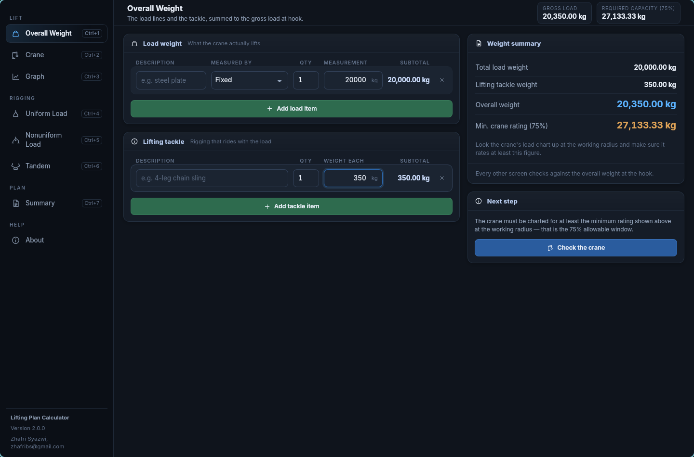
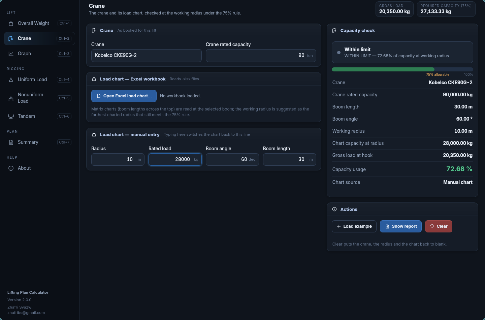
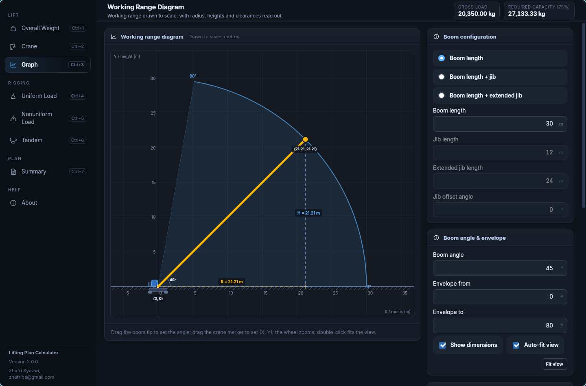
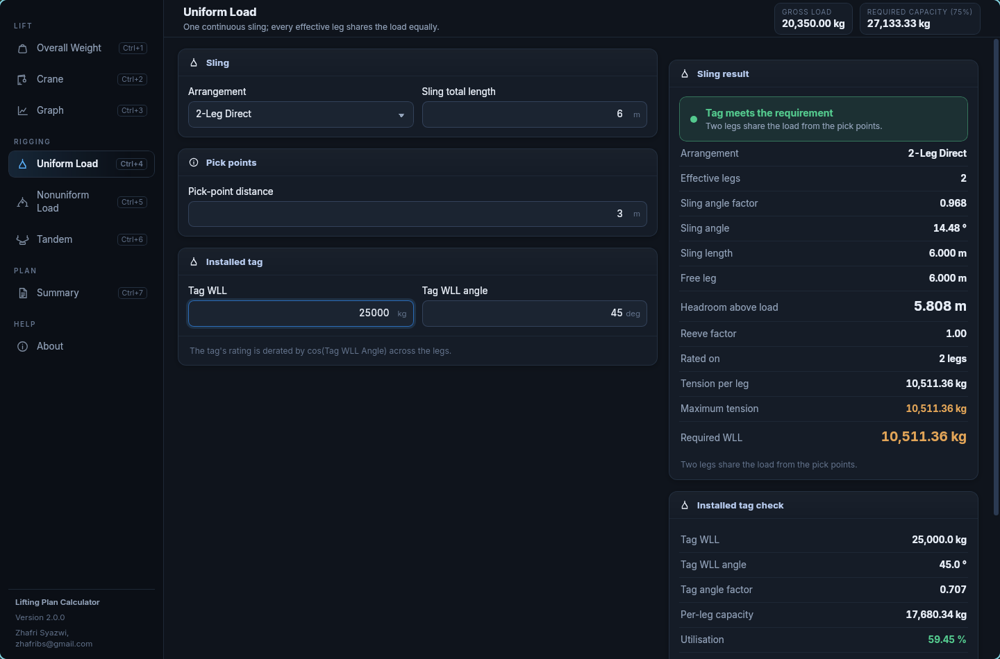
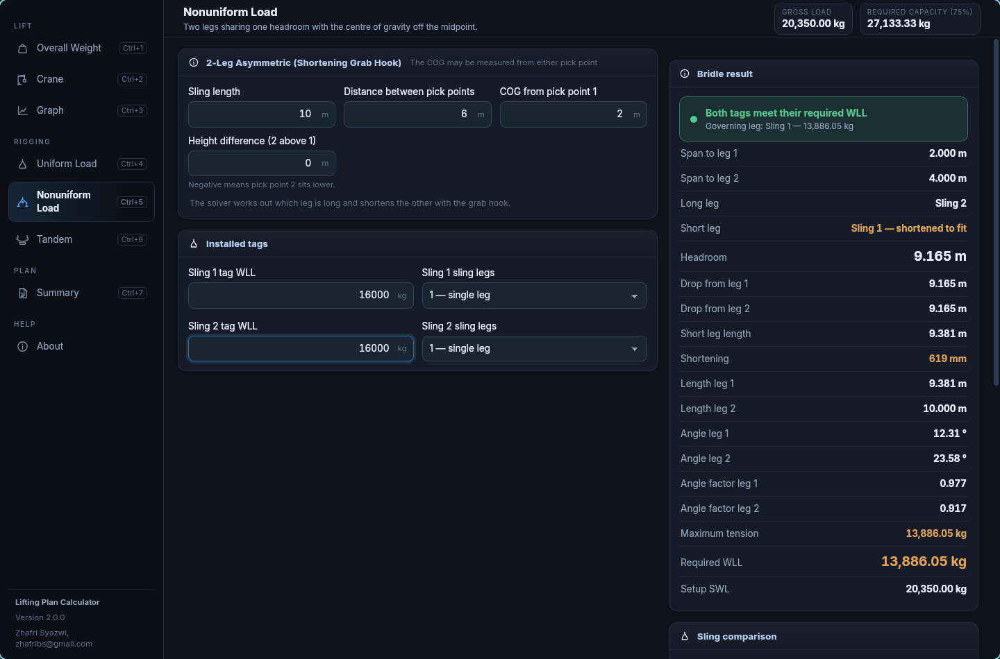
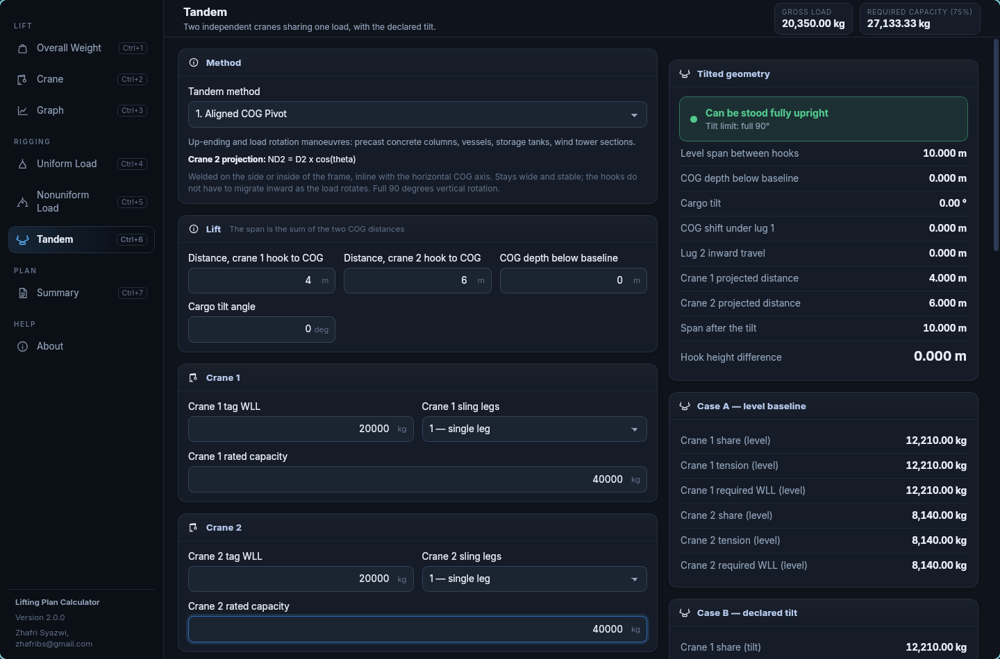
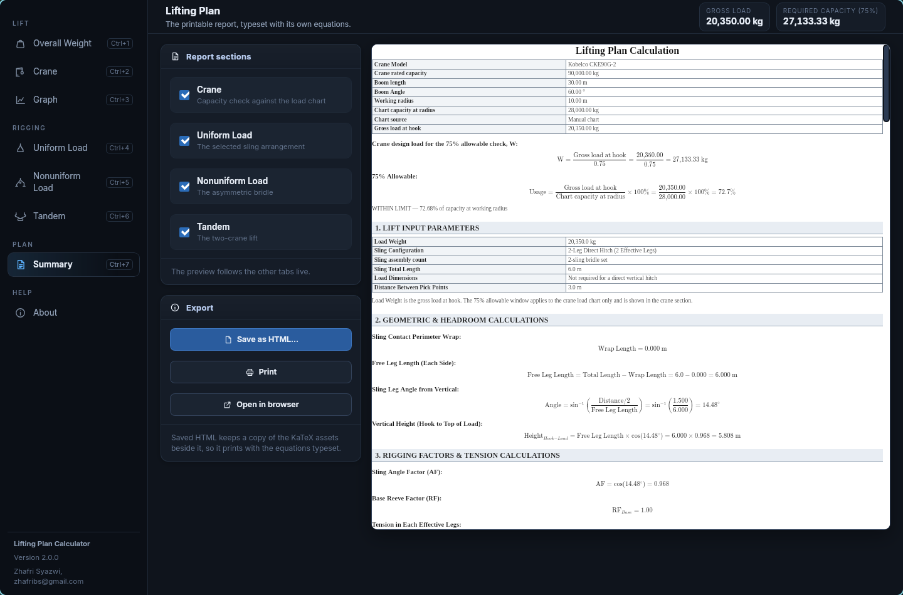

<p align="center">
  
</p>

<h1 align="center">Lifting Plan Calculator</h1>

<p align="center">
  A desktop lift plan that shows its arithmetic — every figure in the printable
  report is written as the formula that produced it.
</p>

<p align="center">
  <a href="https://github.com/zhafribs/lifting-plan-calculator/actions/workflows/ci.yml"></a>
  <a href="https://github.com/zhafribs/lifting-plan-calculator/releases/latest"></a>
  <a href="https://github.com/zhafribs/lifting-plan-calculator/releases"></a>
  <a href="LICENSE"></a>
  <br>
  
  
  
</p>



Rigging and crane lifts, calculated and documented in one window: the load at
the hook, the crane's rated capacity, the sling arrangement, and a plan you can
print, sign and file. Every figure is solved by a Rust engine ported line for
line from the original Android Kotlin source and covered by the Kotlin tests'
own expected values, so a drift in the arithmetic fails the build.

There is no sign-in and no plan is stored by the app itself. It asks GitHub once
per launch whether a newer release exists, and again only if you ask from the
About screen. The only other network traffic is the installer you choose to
download from the update reminder or the About screen, on Windows. Files are
written only when you save a report (the HTML and its KaTeX assets), when that
installer is downloaded, and the small
`~/.cache/lifting-plan-calculator/ui.log` breadcrumb used to diagnose startup
problems.

## Scope of use

This is a calculation aid for a competent person planning a lift. It does not
certify a lift, a crane, an operator or a plan, and it is not a substitute for
the manufacturer's load chart, the crane's rated capacity, the site's lift plan
procedure, or a rigger's and appointed person's judgement. Every figure is only
as good as the inputs and the chart it is read from — check both against the
source before the lift. A printed plan from this app remains the responsibility
of the person who approves it.

## Download

| Platform | File | Runs on |
| --- | --- | --- |
| **Linux** (recommended) | `Lifting-Plan-Calculator-<version>-linux-x86_64.AppImage` | Ubuntu 22.04+, Fedora 36+, Arch (glibc 2.35 floor) |
| **Windows** 10/11 x64 | `Lifting-Plan-Calculator-<version>-windows-x86_64.msi` | WebView2 runtime (the installer ships the bootstrapper) |
| **Windows** 10/11 x64 | `Lifting-Plan-Calculator-<version>-windows-x86_64-setup.exe` | NSIS installer, same build |

All files, their checksums and their release notes are on the
[**Releases page**](https://github.com/zhafribs/lifting-plan-calculator/releases/latest).

```bash
# Linux: one file, nothing to install
chmod +x Lifting-Plan-Calculator-<version>-linux-x86_64.AppImage
./Lifting-Plan-Calculator-<version>-linux-x86_64.AppImage
```

The portable AppImage bundles the GTK 3 and WebKitGTK 4.1 stack it needs, so
nothing app-specific has to be installed on the target machine. Its glibc floor
is 2.35 because it is built inside an Ubuntu 22.04 userspace, not on the
maintainer's rolling-release desktop.

### Verify a download

Every release carries `SHA256SUMS.txt`. Download it beside the file you want and
check just that file — the list names all of them, so a whole-list check fails
for anyone who took one asset:

```bash
sha256sum -c --ignore-missing SHA256SUMS.txt
```

The checksums travel over the same connection as the files, so they catch a
corrupted or truncated download, not a compromised release. Windows will warn
that the installers are unsigned (SmartScreen shows "Unknown publisher"); the
source for every build is this repository.

### Updating

- **Windows:** the app's update reminder can download and start the newer
  installer, then closes so it can replace the running files.
- **Linux:** since v2.2.0 the AppImage ships a matching `.AppImage.zsync`
  sidecar, so `appimageupdatetool` (from AppImageUpdate) downloads only the
  blocks that changed rather than the whole file:

  ```bash
  appimageupdatetool Lifting-Plan-Calculator-<old-version>-linux-x86_64.AppImage \
    https://github.com/zhafribs/lifting-plan-calculator/releases/download/v<version>/Lifting-Plan-Calculator-<version>-linux-x86_64.AppImage.zsync
  ```

  Replace both version placeholders with the release you are updating to; the
  `.zsync` file has the same name as the AppImage plus `.zsync`.

## What it does

Five calculation forms over one shared lift, plus a printable report:

| Tab | What it does |
| --- | --- |
| **Overall Weight** | Load lines and tackle, summed to the gross load at the hook. |
| **Crane** | The capacity check against a load chart imported from Excel, or a single point typed by hand, read against the same 75% band. |
| **Uniform Load** | The nineteen 1-leg / 2-leg / nested / bridle arrangements, each checked against the gross load at hook. |
| **Nonuniform Load** | The 2-leg asymmetric bridle with a shortening grab hook. |
| **Tandem** | Two independent cranes sharing one load, in the two declared lug configurations. |
| **Summary** | An HTML report with KaTeX-typeset formulas, ready to save or print. Saved reports keep a copy of the KaTeX assets beside them, so they print with the equations typeset anywhere. |

The **Graph** tab is the working-range diagram, drawn to scale. In **Summary**,
check **Working range diagram** — between the Crane and Uniform Load sections —
to include the current diagram at the bottom of Plan details; it refreshes with
the plan, and clearing the tick removes it. The report inverts it to a light
background so it prints without a black block.

The chart check is a band, not a cap: at or under 75% of the charted capacity
the plan reads **WITHIN LIMIT**, between 75% and 100% **CAUTION**, and above
100% **WARNING**. Since 2.5.0 the crane's own booked rating is checked against
the same 75% test when a rating is entered; with none entered the plan says
**Not checked** rather than inventing a pass. A working radius outside the chart's rated range
is refused outright, naming the range the chart rates, instead of carrying the
nearest charted capacity in. The reasoning behind each is recorded in
[`docs/adr/`](docs/adr/).

## Screenshots

The form tabs below are live captures from v2.0.0, when the layout was last
captured; the report capture predates the 2.5.0 *Plan details* card and the 2.5.1
head layout. They show an example lift: 20,000 kg of load plus 350 kg of tackle,
giving a 20,350 kg gross load and a 27,133.33 kg required capacity at the 75%
rule. That lift is deliberately over the example crane's 20 t rating, so the plan
shows its over-capacity band.

| Overall Weight | Crane capacity check |
| --- | --- |
|  |  |
| **Working range diagram** | **Uniform Load** |
|  |  |
| **Nonuniform Load** | **Tandem** |
|  |  |

**Summary report** — the printable plan, with each figure shown as its formula.
This capture predates 2.5.0, which added the *Plan details* card, and 2.5.1,
which packed the plan's head into the top third of the sheet; it also predates
the scope line now printed at the foot of the plan and the summary-card head:



## From source

```bash
git clone https://github.com/zhafribs/lifting-plan-calculator.git
cd lifting-plan-calculator/src-tauri
cargo run            # debug build, opens the calculator
```

The frontend lives in `ui/` and is embedded into the binary at compile time —
there is no Node.js build step and no npm dependency.

### Building the AppImage

```bash
./build-appimage.sh            # host build: fastest, runs on distributions at
                               # least as new as the host's glibc

./build-appimage-portable.sh   # portable build: inside an Ubuntu 22.04 userspace
                               # (bubblewrap; no root needed) so the file runs on
                               # Ubuntu 22.04+, Fedora 36+ and Arch
```

Both write `dist/Lifting-Plan-Calculator-<version>-linux-x86_64.AppImage` plus
its `.AppImage.zsync` delta-update sidecar (the sidecar step needs the `zsync`
package; it is skipped with a notice if `zsyncmake` is missing).

Requirements: Rust (cargo), `python3` (both scripts read the version from
`tauri.conf.json`), and a system with `webkit2gtk-4.1`, `gtk3` and `librsvg`
development packages. The scripts install the Tauri CLI if missing, and fetch
the PDF renderer (`scripts/fetch-pdf-renderer.sh`, ~128 MB, pinned; unpacked to
`src-tauri/pdf-renderer/`, which is not in git). `build-appimage-portable.sh`
needs `bwrap` and an internet connection on its
first run (it caches a ~30 MB Ubuntu base rootfs under
`~/.cache/lifting-plan-calculator-build`). A Dockerfile with the same effect
lives in `packaging/Dockerfile` for environments where Docker is preferred.

**Why two build paths?** A host build links against the host's glibc and bundles
the host's GTK/WebKitGTK, which were themselves built against it — so an
AppImage built on a rolling-release system refuses to start on an older LTS
(`version 'GLIBC_2.44' not found`). The portable build fixes the floor at glibc
2.35, the Ubuntu 22.04 baseline.

## Tests

```bash
cd src-tauri
cargo test
```

176 tests: 163 ported from the Kotlin unit suite (`CalcTest`, `CraneTest`,
`CraneManualEntryTest`, `SlingTest`, `NonuniformTest`, `ExcelImportTest`,
`ReportTest`, `ReportUniformTest`, `ReportCapacityTest`,
`ReportNonuniformTest`), plus 13 tests of the Rust port itself (load figures,
model totals, the update check). The expected figures are the Kotlin tests' own
literals, so a drift in the arithmetic fails the build.

The same suite runs on every push and pull request, with `cargo clippy
--all-targets -- -D warnings`, a syntax check of every frontend module, and the
release-notes check and its self-test, in [CI](.github/workflows/ci.yml). Windows
and Linux release builds are produced from the same source by the
[release workflow](.github/workflows/release.yml).

## Project layout

```
src-tauri/          the Rust crate
  src/
    calc.rs         engine primitives (the 75% rule, chart lookup, bands)
    model.rs        load lines, tackle, totals
    crane.rs        the crane form and its capacity check
    sling.rs        the nineteen uniform-load arrangements
    nonuniform.rs   the asymmetric bridle and the two tandem methods
    excel.rs        xlsx load-chart reading and the import rules
    report*.rs      the HTML report builders (KaTeX equations)
    commands.rs     the Tauri command surface
    dto.rs          the wire shapes the UI talks in
  examples/         dev-only fixture dumper for UI work
  icons/            generated from the app's crane icon
ui/                 the frontend (plain ES modules; no build step)
  js/screens/       one module per screen
  vendor/katex/     bundled KaTeX (report typesetting)
docs/releases/      one release note file per tag; the tag's file is published
docs/adr/           architecture decisions, one file per decision
docs/council/       the review charter, the seats, and the decision records
build-appimage.sh            host AppImage build (+ .zsync sidecar)
build-appimage-portable.sh   Ubuntu 22.04 userspace build (widest compatibility)
packaging/check-release-notes.sh    validates every tag's notes
packaging/publish-release-notes.sh  republishes existing release bodies
packaging/make-zsync.sh      writes the AppImage delta-update sidecar
packaging/Dockerfile         the same, for Docker users
```

## Releases

Versioning follows [Semantic Versioning](https://semver.org/spec/v2.0.0.html)
and the change log follows [Keep a Changelog](https://keepachangelog.com/):
breaking changes in the engine's behaviour or the plan's output are a major
bump, new checks and screens a minor, fixes a patch.

Each tag has one notes file in [`docs/releases/`](docs/releases/), and the
release workflow publishes exactly that file as the release body: it refuses a
tag whose notes are missing, empty, or name another version. `CHANGELOG.md`
holds the same changes in one continuous history; the notes are the shorter,
user-facing subset. The process is written down in
[`docs/releases/README.md`](docs/releases/README.md).

Two of the 13 pages published before that process used to repeat earlier notes:
v2.5.0 carried 2.4.0, and v2.5.1 carried 2.5.0 and 2.4.0. All 13 were
republished from the same files on 13 November 2026; the eleven single-release
pages were rewritten to the same shape, but their substance did not change.

What the release pages deliberately do not do: they carry no screenshots (this
page has them), there is no changelog inside the app — the update reminder links
to the GitHub release — and the installers are unsigned, so Windows shows its
"Unknown publisher" warning.

## Desktop notes

- **Excel import**: pick a `.xlsx` load chart; both matrix charts (boom lengths
  across the top) and column charts (radius / load / boom columns) are detected
  automatically. The working radius is suggested as the farthest charted radius
  that still meets the 75% rule. Two example charts ship in `docs/examples/`
  (a 35 t TR-350M-1 and a 20 t TL-200M) if you want to try the import without a
  workbook of your own; the TL-200M also ships as its manufacturer's
  specification PDF, which the workbook transcribes.
- **Printing and PDF**: the report preview is a web view; *Save as PDF* writes
  the report directly to A4 with a one-inch margin on every side. The AppImage
  carries its own headless Chromium (pinned, fetched at build time), so the
  export needs no browser on the target machine; Windows uses the Edge that
  ships with the system, and a system Chromium is the fallback if the payload is
  missing. *Print* opens the system print dialog, and *Save as HTML* writes a
  portable copy. The page declares the same A4 one-inch margin, so a browser's
  print dialog must leave its margin selector on **Default**; *Minimum* and
  *None* override it. Every page carries
  the plan reference on the left, the credit line in the centre (editable in
  Summary, between Plan details and Export), and `n / total` on the right, in
  the bottom margin. If the desktop
  cannot print from a web view, save the file and print it from a browser.
- **Data**: nothing is stored between launches by design; every run opens a
  blank sheet. Use the report's *Save as HTML* to keep a plan.
- **NVIDIA note**: WebKitGTK's DMA-BUF renderer can crash on some NVIDIA driver
  combinations before the window draws. The app detects the NVIDIA kernel
  module and falls back to the software renderer on its own; set
  `WEBKIT_DISABLE_DMABUF_RENDERER=0` to override that choice.

## Contributing

Issues and focused pull requests are welcome — see [CONTRIBUTING.md](CONTRIBUTING.md)
and the [Code of Conduct](CODE_OF_CONDUCT.md). Questions and usage help belong
in [Discussions](https://github.com/zhafribs/lifting-plan-calculator/discussions).
Security reports go through [private advisories](SECURITY.md), never a public
issue.

## License

Copyright (C) 2026 Zhafri Syazwi.

This program is free software: you can redistribute it and/or modify it under
the terms of the GNU General Public License as published by the Free Software
Foundation, either version 3 of the License, or (at your option) any later
version. See [LICENSE](LICENSE) for the full text.

It bundles KaTeX (MIT) and the Inter font (SIL OFL 1.1); see
[THIRD_PARTY_NOTICES.md](THIRD_PARTY_NOTICES.md).
