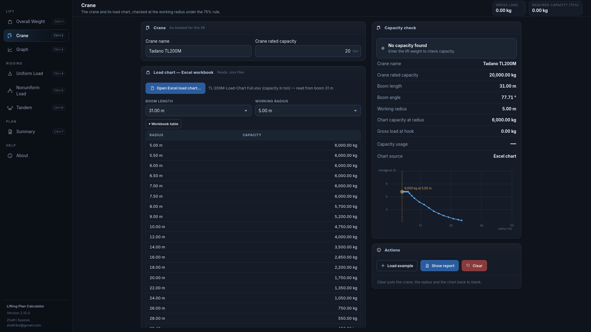
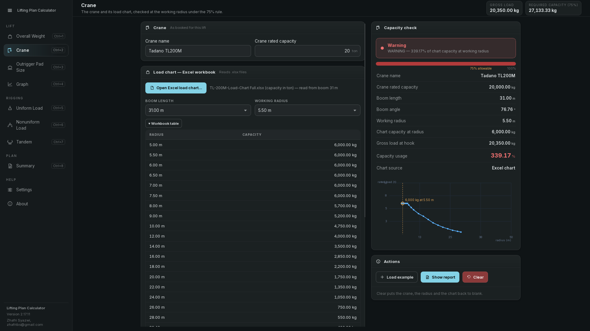
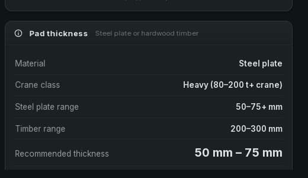
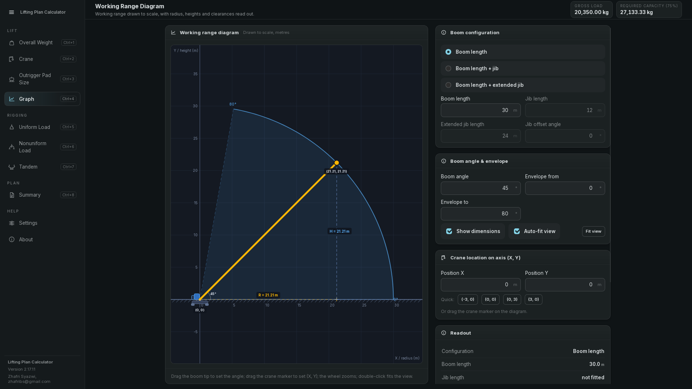
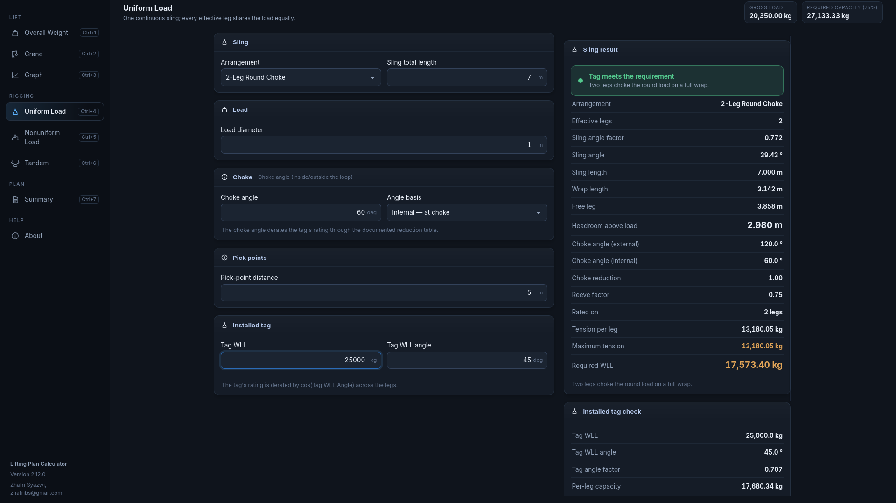

# Lifting Plan Calculator: a practical tutorial

Welcome to the Lifting Plan Calculator. This guide walks through every tab in the order you will use them, using the same example lift as the screenshots: **20,000 kg of load, 350 kg of lifting tackle, and 20,350 kg at the hook**.

Think of it as the walkthrough I would give you at a demo table: no jargon, just the fields to fill and the checks that matter. You can read it from start to finish, or jump to the tab you need.

**Prefer to watch?** The [52-second walkthrough](video/tutorial.mp4) follows a 4,000 kg round load on a 2-Leg Round Choke from Overall Weight through to a saved PDF. It predates the Outrigger Pad Size tab, which is covered in section 3 below. The screenshots use the larger 20,350 kg example so the 75% warning is visible. They are from the 2.17.x line.

## Contents

1. [Before you start](#before-you-start)
2. [Overall Weight](#1-overall-weight)
3. [Crane](#2-crane)
4. [Outrigger Pad Size](#3-outrigger-pad-size)
5. [Graph](#4-graph)
6. [Uniform Load](#5-uniform-load)
7. [Nonuniform Load](#6-nonuniform-load)
8. [Tandem](#7-tandem)
9. [Summary](#8-summary)
10. [About](#9-about)
11. [Common questions](#common-questions)

## Before you start

- The lift tabs work in **kilograms and metres**. The Outrigger Pad Size tab uses **kN and kPa**; one tonne is about 9.81 kN.
- Have the crane's own load chart ready. The app imports `.xlsx` workbooks and also accepts a single chart point typed by hand.
- For the outrigger pad, have the ground information ready. The tab uses the BS 8004 Table 1 presumed bearing values; the same table is in `docs/examples/Presumed Allowable Bearing Values (BS 8004 Table 1).xlsx`, with the thickness guidance on its **Thickness** sheet.
- The **75% rule** is the safety band used throughout: the required chart capacity is the gross load at the hook divided by 0.75. A 20,350 kg lift therefore needs at least **27,133.33 kg** of charted capacity.
- No plan is stored between launches unless you save one. **Save plan** on the Summary screen writes the inputs and the report settings; **Save as PDF** writes the plan you print.
- This is a calculation aid. Check every input and every chart against the source before the lift, and have the finished plan approved by the competent person on site.

## Quick start

1. Add the load and the lifting tackle in **Overall Weight**.
2. Open the crane's Excel chart in **Crane**, or type a manual chart point.
3. Check the capacity band. Green is within 75%, amber is between 75% and 100%, red is over 100%.
4. Size the outrigger pad in **Outrigger Pad Size**.
5. Choose the sling arrangement in **Uniform Load**, **Nonuniform Load** or **Tandem**.
6. Review the **Summary** and save or print the plan.

### On Windows 11

The Windows build uses the Windows 11 Fluent shell: a native title bar over Mica, Segoe UI Variable, and a NavigationView rail that folds to an icon strip with the hamburger at the top of the rail. It follows the Windows light/dark setting and the system accent colour while it runs. Windows 10 shows the same layout on solid surfaces because Mica is not available there; the report and the PDF are identical on every platform.

---

## 1. Overall Weight

The Overall Weight tab is where every lift starts. It adds the load lines and the rigging into one gross load at the hook.

### Add a load item

1. Click **Add load item**.
2. Give the item a description, for example `steel plate`.
3. Choose **Measured by**:
   - **Fixed** uses a weight for each item. Enter the weight in kilograms and the quantity.
   - **Weight by Metre** uses a weight per metre and a length. This suits pipe, beam and cable.
   - **Weight by Volume** uses a volume and a density. This suits tanks and bulk material.
4. Enter the quantity. The subtotal updates as you type.
5. Add another line for every separate item in the lift.

### Add lifting weight

1. Click **Add tackle item**.
2. Describe the item, for example `4-leg chain sling`, `shackles` or `hook block`.
3. Enter the quantity and the weight of each item in kilograms.
4. Repeat for everything that rides with the load: slings, shackles, spreader beams, the hook block and any attached rigging.

The app calls this **Lifting tackle**. It is the lifting weight that gets added to the load. You do not need a separate field for it.

### Read the Weight summary

The card on the right shows:

- **Total load weight**: the sum of the load lines.
- **Lifting tackle weight**: the sum of the rigging.
- **Overall weight**: the gross load at the hook. This is the figure the Crane tab checks.
- **Min. crane rating (75%)**: the charted capacity the crane must have at the working radius. It is the overall weight divided by 0.75.

When the figures look right, click **Check the crane**.

---

## 2. Crane

The Crane tab does two things: it records which crane is on the job, and it checks the gross load against the crane's load chart at the working radius. The capture uses the 20,350 kg example, so the 20 t chart shows the warning band. The walkthrough video uses a 4,350 kg round load and stays within limit.

### Crane identity

Enter the **Crane name** and the **Crane rated capacity**. The rated capacity is printed on the plan for the record. The charted capacity at the working radius is the figure used for the 75% check.

### Open an Excel load chart

1. Click **Open Excel load chart...**.
2. Choose an `.xlsx` file. Files must be `.xlsx`, not `.xls` or `.xlsm`, and the workbook must be 24 MB or smaller.
3. The app looks through the sheets and uses the first load chart it recognises.

Two chart layouts are supported:

- **Column chart**: a header row with a radius column and a load column. A boom column is optional. Useful header names include `Radius`, `Working radius`, `R`, `Load`, `Rated load`, `Capacity`, `SWL`, `Boom`, `Boom length` and `Length`.
- **Matrix chart**: boom lengths across the top row, working radius down the first column, and capacities in the cells.

A title line above the chart can name the crane and its rating, for example `Tadano TL200M (20 ton)`. The app reads that line and fills in the crane name and rated capacity for you.

Things worth knowing about the import:

- Put the unit in the load column header, or add a line that says `Unit: ton` or `Unit: kg` above the chart. A header containing `ton` or `kg` also works. The app converts tonnes to kilograms. If no unit is shown, it treats the figures as kilograms.
- In a matrix chart, values of 2,000 or less are assumed to be tonnes, and larger values are assumed to be kilograms, unless the workbook declares a unit.
- A matrix chart is read from the longest main boom by default. You can choose another boom length from the **Boom length** list after the import.
- The **Working radius** list shows the charted radii at the selected boom.
- If the workbook carries a jib sheet, a **Jib configuration** card appears. Choose the main boom, boom with jib, or boom with extended jib, then set the boom angle and jib offset angle.
- The app suggests the farthest radius that still meets the 75% rule. Enter the lift weight first, or the suggestion cannot be calculated.

The workbook table starts collapsed after an import, so the chart controls stay in view. Click **▸ Workbook table** to open it, and **▾ Workbook table** to fold it away. It is a quick way to confirm the import picked up the right columns.

### Use manual data

Manual entry is useful when you only have a single chart point, or a company-specific chart that is not in a workbook.

1. Fill in **Radius**, **Rated load**, **Boom angle** and **Boom length**.
2. The chart source switches to **Manual chart**.
3. Check the capacity card on the right.
4. To start another crane or company, click **Clear** and enter the new figures.

Manual data is treated as the chart for this plan. It is not saved when the app closes.

### Read the capacity check

The badge and meter on the right show the result:

- **WITHIN LIMIT** is green. Capacity usage is 75% or less.
- **CAUTION** is amber. Capacity usage is above 75% and up to 100%.
- **WARNING** is red. Capacity usage is above 100%.

The rows underneath show the crane, boom length, boom angle, working radius, chart capacity, gross load at the hook and capacity usage. The plot marks the working radius on the chart curve.

The chart is the rating that matters. The **Crane rated capacity** field is printed for the record and is not used as a second pass or fail test. A working radius outside the chart's rated range is refused, and the app names the range the chart covers.

---

## 3. Outrigger Pad Size

This tab sizes the bearing area under one outrigger. It uses the BS 8004 Table 1 presumed allowable bearing values adapted for Malaysian practice. The formula is:

**A = 0.65 × (CM + L) / V**

- **0.65** is the published constant.
- **CM** is the total mass of the crane, as a weight in kN.
- **L** is the load being lifted, in kN.
- **V** is the maximum permissible safe bearing capacity, in kPa.

The result is the bearing **area**. Pad thickness, steel plate design, timber grade and the crane manufacturer's outrigger reaction are separate checks.

### Choose the ground

1. Pick a **Ground category**.
2. Pick the **Soil / rock description**. The table value loads into **V**, and the field note appears below it.
3. If the row is a range, the lower bound is loaded for preliminary sizing. Change **V** if the geotechnical report gives a site-specific value.
4. Rows marked **Not applicable** are refused. Peat, organic soils and uncontrolled fill need piling, ground improvement or a site-specific assessment.

The **Ground reference** card keeps the category, description, table value and field note beside the result.

### Enter the loads

- **Crane mass (CM)** defaults to the Crane tab's rated capacity, converted from tonnes to kN. One tonne is about 9.81 kN. Edit it to override the link.
- **Lift load (L)** defaults to the gross load in the Overall Weight tab. Edit it to override the link, or click **Use overall weight** to reconnect it.
- **Use crane tab** reconnects CM to the crane rated capacity. **Use overall weight** reconnects L to the overall weight.
- The app shows the design load: **0.65 × (CM + L)**.

### Read the minimum pad size

- **Required pad area (A)** is the formula result.
- For a square pad, the **minimum pad** is `√A`, rounded up to the next 50 mm.
- For a rectangular pad, choose **Rectangular**, enter the width you have, and the app calculates the minimum length from `A / width`, rounded up.
- A larger pad is acceptable. The app gives the minimum bearing size; it does not apply a second utilisation band.
- The plan view shows the minimum pad and the outrigger point.

### Choose the pad material and thickness

The **Pad** card also chooses the material:

- **Steel plate**: 25–32 mm for light cranes, 35–50 mm for medium, and 50–75 mm+ or structural I-beam mats for heavy.
- **Hardwood timber**: 75–100 mm for light cranes, 150–200 mm for medium, and 200–300 mm bolted crane mats for heavy.

The crane class comes from the Crane tab's rated capacity. If the manufacturer gives a higher outrigger leg load, use the next class.

For timber, entering the **outrigger foot length** and **width** checks the 45° load-spread rule: the timber thickness should roughly equal the overhang from the foot to the pad edge. A timber pad wider than 1.2 m should be cross-layered, with two or more 100–150 mm hardwood layers at 90° and a steel plate on top.

A steel plate wider than 1.2 m × 1.2 m needs at least 40–50 mm, or welded stiffening ribs. Never use plywood, OSB, hollow blocks or softwoods.

The **Pad thickness** card shows the class, both material ranges, the recommended thickness, the governing check and any cross-layering or stiffener note. The same guidance is on the **Thickness** sheet of `Presumed Allowable Bearing Values (BS 8004 Table 1).xlsx`.

### What to check before the lift

- The **V** value comes from the right ground row, and is confirmed by the geotechnical assessment.
- **CM** is the crane mass used by the formula; the default is the Crane tab's rated capacity.
- **L** is the load lifted. If you use the overall weight, remember it includes the lifting tackle.
- The pad is fully supported, the ground is drained, and the crane manufacturer's outrigger reaction has been checked separately.

## 4. Graph

The Graph tab draws the working range to scale. It is a visual check on the crane setup, not a separate calculation.

- **Boom configuration** lets you choose the main boom, boom with jib, or boom with extended jib. The jib fields light up when they apply.
- **Boom angle & envelope** sets the boom angle and the envelope from and to angles. **Show dimensions** adds the measurements to the drawing. **Auto-fit view** keeps the diagram in the window. **Fit view** redraws it on demand.
- **Crane location on axis (X, Y)** sets where the crane sits. You can type the position, use one of the quick buttons, or drag the crane marker on the diagram.
- **Readout** shows the working radius, tip height, envelope radius, boom angle, tip location and ground clearance.

When a new-format workbook is loaded in Crane, the diagram follows the crane position, boom length and working radius from that tab. If you edit the diagram by hand, a **Reset to Crane Tab** button appears so you can return to the workbook position.

To put the diagram in the report, tick **Working range diagram** in the Summary tab.

---

## 5. Uniform Load

Use Uniform Load when one continuous sling shares the load across its legs. The app lists 19 arrangements, including the common one-leg, two-leg, nested and bridle setups. The screenshots and the video use **2-Leg Round Choke** for a round load.

1. Choose the **Arrangement**.
2. Enter the **Sling total length**.
3. Fill in the load dimensions the selected arrangement asks for: load diameter, side or height, bottom or length.
4. If the arrangement uses a choke, set the **Choke angle** and the **Angle basis**.
5. For pick-point arrangements, enter the pick-point distance, length and width.
6. For nested arrangements, fill in the **Secondary slings** card.
7. Enter the **Tag WLL** and **Tag WLL angle** for the installed tag.

The **Sling result** card shows the effective legs, sling angle factor, sling angle, headroom, tension per leg, maximum tension and required WLL. The **Installed tag check** compares the tag rating with the required WLL. A green result means the tag meets the requirement. A red result means it does not.

If no tag rating is entered, the app still shows the required WLL and reports that there is no tag rating to compare.

---

## 6. Nonuniform Load

Use Nonuniform Load for a two-leg asymmetric bridle with a shortening grab hook. The centre of gravity is off the midpoint, so the two legs carry different tensions.

1. Enter the **Sling length**.
2. Enter the **Distance between pick points**.
3. Enter the **COG from pick point 1**. The COG can be measured from either pick point.
4. Enter the **Height difference (2 above 1)**. A negative value means pick point 2 sits lower.
5. Fill in the **Installed tags** card for sling 1 and sling 2: tag WLL, sling legs and tag WLL angle.

The solver works out which leg is long and shortens the other with the grab hook. The **Bridle result** shows the geometry, and the **Sling comparison** table puts sling 1 and sling 2 side by side. The **Installed tag check** compares each tag with its required WLL.

---

## 7. Tandem

Use Tandem for two independent cranes sharing one load.

1. Choose the **Tandem method**:
   - **Aligned COG Pivot** is for up-ending and load rotation, including full 90 degree vertical rotation.
   - **Repositioned Top Lifting Point** is for level-shifting and drift lifts where the load cannot go vertical.
2. Enter the **Distance, crane 1 hook to COG** and **Distance, crane 2 hook to COG**.
3. Enter the **COG depth below baseline** and the **Cargo tilt angle**.
4. Fill in each crane's tag WLL, sling legs, tag WLL angle and rated capacity.

The right side shows the tilted geometry, Case A (level baseline), Case B (declared tilt), and Case C (full 90 degree vertical rotation) when the method allows it. The **Governing case, per crane** card names the case that sizes each crane. **Crane checks** then compares each crane's required WLL and rated capacity.

The method note under the dropdown explains the second crane's projection rule and the rotation limit. Read it before you choose a method.

---

## 8. Summary

Summary turns the inputs into a printable plan. Every figure is shown with the formula and the values that produced it, so a reviewer can check the arithmetic.

### Choose the report sections

Tick the sections you want:

- **Crane**
- **Working range diagram**
- **Outrigger Pad Size**
- **Uniform Load**
- **Nonuniform Load**
- **Tandem**

The preview follows the other tabs live.

### Fill in the plan details

Enter the **Plan reference**, **Prepared by**, **Checked by** and **Approved by**. These lines are printed on the plan and are not used by the calculation engine. The **Issued** date is taken from the plan: a saved plan keeps the date it was saved with, and a new plan starts with today's date.

You can also edit the **Footer** centre text. It is printed in the centre of every page.

### Preview and export

- **Pages** shows the report as the PDF pages that will be saved, with page breaks. **Live** shows the HTML preview as you type.
- Use **Fit width**, the zoom buttons and **Refresh** to inspect a page.
- **Margins** opens the page margin panel. The default is 25.4 mm, and the presets cover common metric and imperial sizes.
- **Save plan** writes the inputs and the report settings to a JSON file you choose; no plan is kept between launches unless you save one.
- **Open plan** loads such a file and replaces the current plan. The workbook's table view is not saved; re-import the workbook if you need the full sheet on screen.
- **Save as HTML** writes a portable copy with its KaTeX assets beside it.
- **Save as PDF** writes A4 pages with the margins you set and the footer on every page.
- **Print** opens the system print dialog.
- **Open in browser** opens the saved report in your default browser.

If the desktop cannot print from the preview, save the HTML and print it from a browser. Keep the browser's margin setting on **Default** so the app's A4 margin is not overridden.

The [walkthrough video](video/tutorial.mp4) shows the full Summary flow: tick the working-range diagram, open **Margins**, choose the 20 mm preset, apply it, and save the PDF.

---

## 9. About

The About tab shows the app version, what the calculator does, the developer contact details and the update controls.

- **Check for updates** asks GitHub whether a newer release exists. If the GitHub API is rate-limited, it reads the release feed instead.
- **Visit repository** opens the project on GitHub.
- On Windows, when a newer release is available, the update card can download and start the installer. On Linux, it downloads the new AppImage, replaces the running file and restarts the app.

The app needs no sign-in, and all calculations run on your machine.

---

## Common questions

### Why does the Crane tab say "No capacity found"?

The gross load at the hook is still zero. Add a load item in **Overall Weight** and the check will run. The message "Enter the lift weight to check capacity" is the app's way of saying it has no load to compare against the chart.

### Why does the app refuse my working radius?

The radius is outside the range the chart covers. Pick a radius inside the chart, or check that the correct boom length is selected. The app will not borrow the nearest charted capacity from outside the rated range.

### Why does the import say it cannot find a load chart?

The workbook needs either a header row with radius and load columns, or a matrix with boom lengths across the top and radius down the first column. Rename the headers to plain names such as `Radius` and `Load`, or move the chart onto its own sheet. Save `.xls` and `.xlsm` files as `.xlsx` first.

### Why is the tag check red?

The installed tag's rating is below the required WLL for the arrangement. Use a higher-rated tag, add more legs where the arrangement allows it, or reduce the sling angle.

### Why does the Summary say "No pages"?

The report has no sections selected, or the preview has not drawn yet. Tick at least one section and give the app a moment to redraw. The page view waits until typing stops.

### Why can't I calculate a pad for peat or fill?

Peat, organic soils and uncontrolled fill are marked **Not applicable** in the BS 8004 table. They are too compressible for a shallow pad, so the app refuses the calculation. Use piling or ground improvement, or obtain a site-specific bearing value and a designed foundation.

### How do I size a rectangular pad?

Choose **Rectangular** and enter the width you have. The app calculates the minimum length from `A / width`, rounded up to 50 mm. A larger pad is acceptable.

### Where did my plan go?

The app does not store plans between launches. Use **Save plan** in Summary to keep one, or **Save as HTML** / **Save as PDF** to keep a copy to print or share.

---

## Keyboard shortcuts

| Tab | Shortcut |
| --- | --- |
| Overall Weight | Ctrl+1 |
| Crane | Ctrl+2 |
| Outrigger Pad Size | Ctrl+3 |
| Graph | Ctrl+4 |
| Uniform Load | Ctrl+5 |
| Nonuniform Load | Ctrl+6 |
| Tandem | Ctrl+7 |
| Summary | Ctrl+8 |
| About | No shortcut |

---

## A safe workflow

1. Enter the load and all lifting tackle in Overall Weight.
2. Import the crane's current load chart, or type the chart point from the company's data.
3. Check the working radius and the 75% band.
4. Size the outrigger pad and check the ground value.
5. Choose the rigging arrangement and check the required WLL against the tags.
6. Open Summary, fill in the plan details and include the sections you need.
7. Save the PDF or HTML, print it, and check the finished plan against the source chart before it is approved.

That is the whole app. If you get stuck, the message on screen usually names the field or the limit that needs attention.
